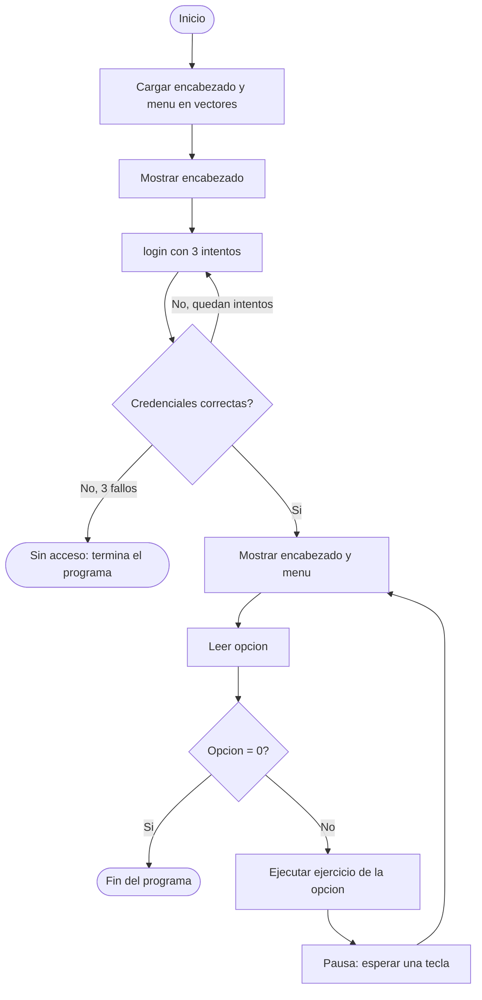

# Trabajo Práctico Integrador — Algoritmos y Programación

**Instituto Superior de Formación Docente y Técnica Nº59**
Carrera: Tecnicatura Superior en Análisis de Sistemas · Curso: 1.º año
Profesor: Dell Arciprete Darío · Alumno: Omar Elvio Mamani Condori
Fecha de entrega: 27/10/2026 · Versión 1

Programa en **PSeInt** (archivo `tpintegrador.psc`) con encabezado de la institución, login con usuario y contraseña cifrados mediante el método César, y un menú con 10 ejercicios de vectores, matrices y el algoritmo de Luhn.

## Requisitos de la consigna

| Requisito | Dónde se cumple |
|---|---|
| Encabezado de la institución | Vector `encabezado` (9 líneas), se muestra antes del login y arriba del menú |
| Menú con 10 ejercicios | Vector `menu` (10 opciones) y `Segun opc` en el algoritmo principal |
| Ejercicios de vectores y matrices | Opciones 1, 2, 3, 4, 7 (vectores) y 8, 9, 10 (matrices) |
| Algoritmo de Luhn | Opción 5 |
| Usuario y contraseña cifrados con César | Función `login`, usa `cifrar` y `descifrar` |
| Al tercer intento incorrecto, sale del sistema | `login(3)` devuelve `Falso` y el programa termina sin mostrar el menú |

## Cómo ejecutarlo

1. Abrir `tpintegrador.psc` en PSeInt.
2. Ejecutar el algoritmo `tpintegrador`.
3. Ingresar las credenciales del login (ver más abajo).
4. Elegir una opción del menú. Con `0` se sale del programa.

**Credenciales de prueba**

| Dato | Valor ingresado | Valor guardado (cifrado, clave 3) |
|---|---|---|
| Usuario | `omar` | `rodu` |
| Contraseña | `eureka` | `hxuhnd` |

Para cambiarlas: cifrar el nuevo texto con la opción 6 del menú (clave 3) y reemplazar `userGuardado` y `passGuardado` dentro de la función `login`.

## Menú de ejercicios

| N.º | Ejercicio | Qué hace |
|---|---|---|
| 1 | Búsqueda lineal de un número | Carga un vector de 5 números y busca uno. Informa la primera posición |
| 2 | Búsqueda lineal de nombres | Igual que el anterior con nombres, sin distinguir mayúsculas |
| 3 | Búsqueda lineal y contar | Cuenta cuántas veces se repite un número en el vector |
| 4 | Notas de alumnos | Carga nombres y notas, ordena con burbuja, muestra tabla y avisa notas repetidas |
| 5 | Verificador de tarjetas | Valida un número de 16 dígitos con el algoritmo de Luhn |
| 6 | Método César | Encripta y desencripta un texto con la clave elegida |
| 7 | Factura de productos | 5 productos con subtotal, IVA 21%, promedio, menor y mayor valor, y aviso si supera $100000 |
| 8 | Buscar un número en una matriz | Matriz 3x3 aleatoria y oculta, con 3 intentos para acertar |
| 9 | Sumar dos matrices | Carga dos matrices 2x2 y muestra A, B y A+B |
| 10 | Contar pares en una matriz | Matriz 3x3, cuenta los pares y muestra sus posiciones |

## Estructura del código

- **`Algoritmo tpintegrador`**: carga los vectores `encabezado` y `menu`, llama a `login(3)` y, si el acceso fue correcto, repite el menú hasta que se elige `0`.
- **`Funcion login(maxIntentos)`**: pide usuario y contraseña, los cifra y los compara con los valores guardados. Devuelve `Verdadero` o `Falso`.
- **`Funcion cifrar(texto, clave)`** y **`Funcion descifrar(texto, clave)`**: implementan el método César. `descifrar` llama a `cifrar` con la clave negativa.
- **`SubProceso ejercicio1` … `ejercicio10`**: un subproceso por ejercicio. Cada uno tiene sus propias variables, así no se pisan los tipos entre ejercicios (por ejemplo `vector` es `Entero` en el 1 y `Caracter` en el 2).

## Cómo funciona el login

1. El usuario y la contraseña **no se guardan en texto plano**: están guardados ya cifrados con César, clave 3.
2. Cuando la persona escribe sus datos, el programa los cifra con la misma clave y compara el resultado con lo guardado.
3. Si coinciden, el acceso es concedido y se descifra el usuario guardado para mostrar la bienvenida.
4. Si no coinciden, se descuenta un intento. Al tercer intento fallido el programa informa "Acceso denegado" y termina.

## Método César

Se usa un alfabeto de 27 letras (`abcdefghijklmnñopqrstuvwxyz`). Cada letra se reemplaza por la que está `clave` posiciones más adelante, y al pasar la `z` se da la vuelta al principio:

```
posnueva = (posicion - 1 + clave) Mod 27
```

Ejemplos con clave 3: `omar` → `rodu`, `hola mundo` → `krñd oxpgr`, `xyz` → `abc`. Los espacios, números y símbolos no se modifican. Una clave negativa descifra.

## Diagrama de flujo



## Notas y limitaciones

- `cifrar` pasa el texto a minúsculas, por lo que el login no distingue mayúsculas de minúsculas.
- PSeInt no oculta la contraseña mientras se escribe.
- Los subprocesos se llaman sin paréntesis (`ejercicio1`). Si la versión de PSeInt lo exige, usar `ejercicio1()`.
- Las matrices y vectores se cargan directamente en el algoritmo principal y no se pasan como parámetro a funciones, porque algunas versiones de PSeInt dan el error 220 ("Faltan subíndices para el arreglo").
